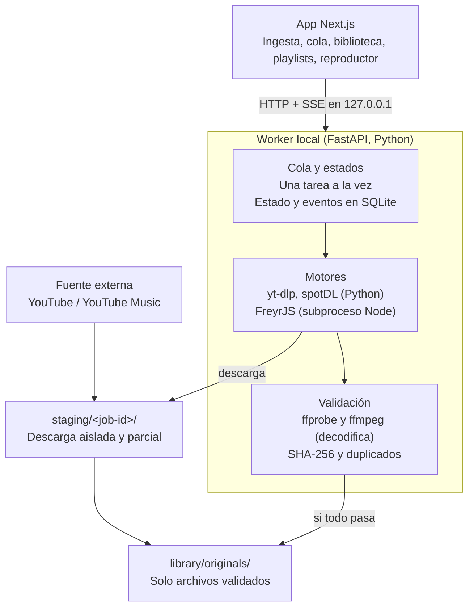

# Spec técnica — Worker de ingesta

3 de noviembre de 2026 · Alexander Oropesa

El worker es un servicio local en la PC del cliente que busca, descarga y valida audio autorizado con yt-dlp, spotDL y FreyrJS, y publica en la biblioteca solo archivos completos y verificados. La app Next.js deja de simular la ingesta y pasa a consumir su API. Recomendación para TBD-09: microservicio en Python (FastAPI), con FreyrJS como subproceso.

## Arquitectura

La app nunca toca los motores ni el disco: crea tareas y escucha su progreso. El worker descarga en un staging aislado, valida con FFmpeg y solo mueve a la biblioteca lo que pasa todas las comprobaciones (RF-ING-04). El reproductor lee el audio desde el worker, en la misma PC.

## Motores

Los tres motores sacan el audio de YouTube o YouTube Music, así que no cuentan como redundancia entre sí (RNF-MAN-03). spotDL y FreyrJS aportan la identificación de catálogo, no otra fuente. El audio de Spotify o Apple Music nunca llega al worker (RF-PRO-06).

| Motor | Runtime | Entrada | De dónde sale el audio | Salida | Uso en el worker |
| --- | --- | --- | --- | --- | --- |
| yt-dlp | Python 3.11+, como librería | URL directa o búsqueda `ytsearchN:<texto>` | La fuente de la URL | Stream original sin recodificar (Opus/WebM, AAC/M4A) | Inspección (`-J`), búsqueda y descarga directa; también lo usa spotDL por debajo |
| spotDL | Python, como librería o CLI | Enlace o búsqueda de Spotify (solo metadatos) | YouTube Music, emparejado por título, artista y duración | MP3 recodificado por defecto | Configurado para conservar el formato de origen; la referencia de Spotify se guarda como `requested` |
| FreyrJS | Node.js, subproceso | Enlaces de Spotify, Apple Music o Deezer | YouTube Music, emparejado | AAC 320 recodificado | Se registra el codec real y la marca «re-encoded by engine», nunca como mejora de calidad (RF-PRO-05) |

Cada motor se activa y se fija a una versión por configuración (RF-ING-11, RNF-MAN-01). Un enlace de Spotify o Apple Music en la ingesta por URL se rechaza para yt-dlp y se ofrece guardarlo como referencia.

Abierto: confirmar en la versión de spotDL que se fije la opción exacta para desactivar la recodificación.

## Ciclo de una tarea

Cada ingesta es una tarea con cinco estados y solo una corre a la vez (RF-ING-01, RF-ING-05). Antes de crearla, la app inspecciona la fuente sin descargar (RF-BUS-01/02): `yt-dlp -J --no-playlist <url>` devuelve título, canal, duración y formatos.

| Estado | Qué hace el worker | Pasa a failed si |
| --- | --- | --- |
| pending | Acepta la tarea solo si trae una autorización y responde con ID y estado (RF-ING-02, RNF-FIA-02). La guarda en la base y la pone en cola | Falta la autorización o está caducada, revocada o en revisión; la duración de la fuente supera el límite |
| downloading | Descarga en `staging/<job-id>/` con `-f bestaudio --no-playlist --max-filesize <MB>`, sin cookies ni cuentas. Emite el progreso real desde los progress hooks | Red (reintentable), tamaño superado, la fuente exige acceso, cancelación |
| validating | Ejecuta las comprobaciones de la sección Validación. Una coincidencia dudosa queda en «validating · awaiting review» y no ocupa el worker | Archivo incompleto, duración fuera de tolerancia o límite, duplicado, coincidencia rechazada por el operador |
| ready | Guarda archivo, procedencia y métricas, y mueve el archivo de forma atómica a `library/originals/`. La tarea termina solo cuando todo está escrito (RNF-FIA-04) | — |
| failed | Registra código, herramienta, versión, fuente y mensaje (RF-ING-12) y borra el parcial del staging | — |

La versión pedida nunca se sustituye en silencio: si la fuente ofrece otra, se registra la limitación (RF-ING-08). Una playlist externa nunca se descarga entera; cada pista es su propia tarea (RF-ING-09).

## Validación

Las comprobaciones corren en este orden sobre el archivo en staging; la primera que falla detiene la tarea y nada llega a la biblioteca.

| Comprobación | Comando o método | Falla si |
| --- | --- | --- |
| Archivo completo | `ffmpeg -v error -i <archivo> -f null -` | Hay cualquier error de decodificación (RF-PRO-02) |
| Codec real | `ffprobe -v error -show_streams -show_format -of json` | Nunca falla: si la extensión no coincide, es un aviso y se registra el codec real (RF-PRO-01) |
| Duración | Duración de ffprobe frente a la fuente o la referencia | Diferencia mayor que la tolerancia TBD-10 (propuesta ±2 s) o más larga que el límite |
| Hash | SHA-256 sobre los bytes originales | — |
| Duplicado | Hash contra los archivos de la biblioteca | Mismo hash que un archivo existente (RF-BIB-04) |
| Coincidencia | Directo, cover, edición o duración distinta frente a la referencia | Queda para revisión; el rechazo del operador termina en failed (RF-BUS-04) |

No se convierte por defecto: solo se crea un derivado compatible si el original no se puede reproducir, y el original se conserva siempre (RF-PRO-03, RNF-FIA-05).

## API del worker

HTTP en `127.0.0.1`, solo accesible desde la propia PC (RI-COM-04). La app sustituye el adaptador simulado de `src/lib/engine.ts` por estas llamadas.

| Método y ruta | Qué hace | Respuesta |
| --- | --- | --- |
| `POST /inspect` | Metadatos y formatos de una URL, sin descargar | Título, canal, duración, formatos, avisos |
| `POST /search` | Búsqueda por texto en uno o varios motores | Resultados con marcas de duda y confianza |
| `POST /jobs` | Crea una tarea con fuente, motor, formato, identidad y autorización | `201` con ID y `pending`, o error explícito |
| `GET /jobs`, `GET /jobs/{id}` | Estado, comprobaciones, eventos y métricas | Tarea completa |
| `POST /jobs/{id}/pause`, `resume`, `cancel`, `retry` | Control del operador | Tarea actualizada |
| `POST /jobs/{id}/review` | Acepta o rechaza una coincidencia dudosa | Tarea actualizada |
| `GET /events` | Stream SSE de cambios de estado y progreso | Un evento por cambio, con número de secuencia |
| `GET /files/{id}/audio` | Sirve el original para el reproductor, con soporte de Range | Bytes del archivo |
| `POST /benchmark/runs` | Lanza las muestras en los motores elegidos | ID de la ejecución |
| `GET /health` | Versiones de motores y FFmpeg, espacio en disco | Estado del worker |

Autorizaciones, artistas, playlists y auditoría siguen siendo responsabilidad de la app; el worker guarda la autorización que recibe con cada tarea como parte de su procedencia.

## Datos persistentes

Todo vive en una base SQLite local para que ninguna tarea se pierda al reiniciar (RNF-FIA-01). La estructura física final se decide con TBD-08; estos son los mínimos.

| Entidad | Campos clave | Para qué |
| --- | --- | --- |
| Tarea | id, código, estado, motor y versión, fuente, formato, identidad, autorización, límites, reintentos, revisión | La cola y su estado |
| Evento de tarea | id de tarea, secuencia, tipo, mensaje, fecha | Log visible y stream SSE; se confirma solo después de guardar el resultado (RNF-FIA-03) |
| Comprobación | id de tarea, clave, estado, detalle | Validación mostrada en la app |
| Archivo | id, pista, tipo (original o derivado), codec, contenedor, bitrate, muestreo, canales, tamaño, duración, SHA-256 (único), ruta | Biblioteca y detección de duplicados |
| Procedencia | URL, plataforma, id de fuente, canal, referencia pedida, herramienta y versión, fecha, operador, IP, tarea | Registro de origen (RF-BIB-03) |
| Fallo | tarea, código, herramienta, versión, fuente, mensaje, fecha | Fallos por proveedor y herramienta (RNF-MAN-02) |
| Métrica | tarea, tiempo de descarga, tiempo de proceso, pico de CPU, pico de memoria, disco | Informe del piloto (RNF-REN-01) |

Carpetas: `staging/<job-id>/` para el trabajo en curso, `library/originals/<artista>/<título>.<ext>` y `library/derivatives/` enlazados a su original.

## Errores y reintentos

Solo se reintentan solos los errores transitorios, con backoff exponencial y hasta el máximo configurado (0 a 3, nunca ilimitado, RF-ING-07). Los fallos de política no se reintentan porque darían el mismo resultado.

| Código | Causa | Reintento |
| --- | --- | --- |
| `NETWORK` | Conexión cortada o timeout | Automático |
| `INCOMPLETE` | El archivo descargado no se decodifica entero | Automático |
| `INTERRUPTED` | Reinicio de la PC o del worker a mitad de tarea | Automático tras recuperar |
| `ACCESS_REQUIRED` | La fuente pide inicio de sesión, membresía o pago | No; se registra la limitación |
| `SIZE_LIMIT` / `DURATION_LIMIT` | Supera los límites configurados | No |
| `DURATION_MISMATCH` | Llega otra versión o un fragmento | No; nunca se sustituye |
| `DUPLICATE` | Mismo SHA-256 que un archivo de la biblioteca | No |
| `MATCH_REJECTED` | El operador rechaza la coincidencia | No |
| `CANCELLED` | Cancelada por el operador | Manual |
| `ENGINE_ERROR` | El motor termina con error no clasificado | Manual; se guarda la salida de error |

## Métricas, benchmark, fiabilidad y aislamiento

El worker cubre lo que el navegador no puede medir ni garantizar.

- **Métricas por tarea (RNF-REN-01, CA-05):** tiempos de descarga y de proceso, pico de CPU y de memoria muestreando el proceso hijo (p. ej. con `psutil` cada 250 ms) y espacio en disco. Los umbrales se fijan con el cliente después del piloto (TBD-11).
- **Benchmark (RF-ING-11, CA-08):** las mismas muestras autorizadas pasan por los tres motores. Se miden tiempo de respuesta, tasa de éxito, precisión de metadatos y coincidencias exactas o dudosas; las ejecuciones se exportan a CSV.
- **Recuperación (RNF-FIA-01):** al arrancar, toda tarea en downloading o validating vuelve a pending con su staging limpio, y queda una nota en su log.
- **Idempotencia (RNF-FIA-03):** reprocesar un evento no duplica archivos; el SHA-256 único lo impide.
- **Aislamiento (RNF-MAN-01, RNF-POR-01):** entorno virtual propio con versiones fijadas, sin tocar el Python del sistema; timeouts por fase; cancelar mata el proceso hijo; los archivos descargados nunca se ejecutan; sin cookies ni cuentas personales.
- **Mantenimiento (RNF-MAN-02, RNF-MAN-04):** `/health` expone las versiones de motores y FFmpeg; los fallos se agrupan por herramienta y causa; las licencias de dependencias se inventarían antes de empaquetar.

## Integración con la app y bloqueos

La app actual ya separa la ingesta detrás de una interfaz, así que el cambio queda acotado.

1. Sustituir el adaptador simulado de `src/lib/engine.ts` por el cliente de la API del worker, con el progreso por SSE.
2. Mover la biblioteca de IndexedDB a disco: el reproductor carga el audio desde `GET /files/{id}/audio` en `127.0.0.1`, y sigue funcionando sin internet (RNF-FIA-06).
3. Recuperar desde git las vistas retiradas (From URL, Text search, Match review, Engine benchmark) y conectarlas a datos reales.
4. Mantener la importación desde disco: el archivo se sube al worker y pasa por la misma validación con FFmpeg.

Bloqueos para empezar:

- [ ] TBD-01: sistema operativo, CPU, memoria y disco de la PC del cliente
- [ ] TBD-03: muestras de repertorio propias o autorizadas (bloquea la Prueba A)
- [ ] Instalar Python 3.11+, Node.js y FFmpeg en esa PC
- [ ] Decidir TBD-09 (microservicio recomendado) y TBD-10 (tolerancia de duración)
