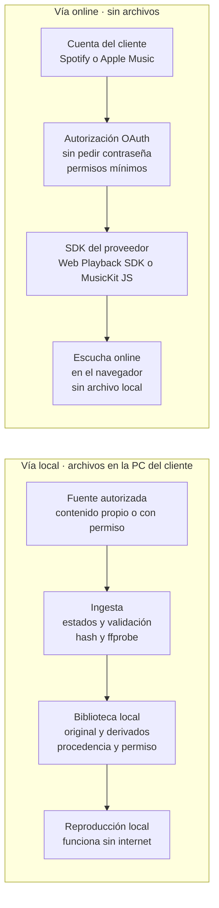
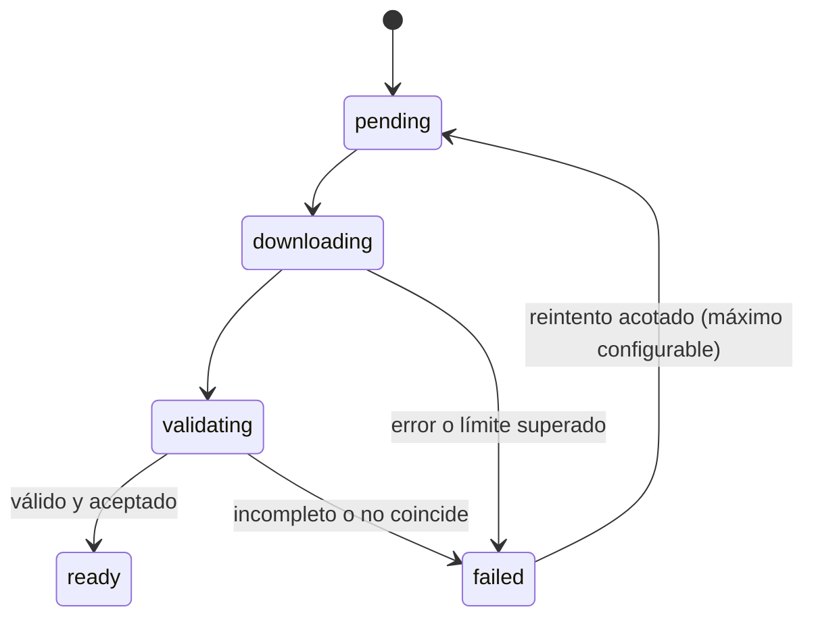

# SRS — Plataforma musical: catálogo, integraciones y piloto

2 de noviembre de 2026

## Control del documento

Esta SRS v0.1 convierte el documento consolidado del 3 de noviembre de 2026 en requisitos verificables. No aprueba arquitectura, proveedores ni contratos.

| Campo | Valor |
| --- | --- |
| Versión | 0.1, borrador para revisión del cliente |
| Documento fuente | «Plataforma musical: catálogo, integraciones y piloto» (§1–§12) |
| Estructura | Basada en ISO/IEC/IEEE 29148 |
| Estado del producto | Sin implementación; piloto solicitado y no ejecutado |
| Idiomas | Documentación en español; interfaz en inglés |

**Convenciones**

- **ID**: RF (funcional), RNF (no funcional), RI (interfaz), RC (cumplimiento), RD (restricción de diseño), CA (criterio de aceptación), TBD (cuestión abierta).
- **Prioridad**: Debe (obligatorio en su fase), Debería (importante, negociable), Podría (deseable).
- **Fase**: Piloto (pruebas A, B o C del §7), Producto (uso habitual tras el piloto), Diferido (alcance por definir).
- **Fuente**: sección del documento fuente (§n). «Derivado» indica un requisito inferido de esa sección, no literal.
- «El sistema» designa la plataforma musical propia: back office y componentes locales.

## 1. Introducción

### 1.1 Propósito

Esta especificación define qué debe hacer la plataforma musical privada del cliente y cómo se comprobará. Separa lo técnicamente viable de lo autorizado y fija los criterios con los que el cliente evaluará el piloto. Está dirigida al cliente, al equipo de desarrollo y a quien revise derechos y condiciones de los proveedores.

### 1.2 Alcance del producto

El sistema es una plataforma musical propia para la escucha personal del cliente, no una estación de radio. Ofrece un back office en inglés para buscar canciones, revisar resultados, decidir qué conservar, organizar playlists y reproducir.

Cubre dos vías independientes:

- **Vía local**: archivos de audio con procedencia y permiso registrados, reproducibles sin internet.
- **Vía online**: escucha de la cuenta Spotify del cliente con las herramientas oficiales y, si el cliente lo pide, Apple Music. No genera archivos.

Objetivos del primer ciclo:

1. Ejecutar las pruebas A (biblioteca local) y B (Spotify online), y C (Apple Music) si se solicita, con los criterios del §7.
2. Comparar yt-dlp, spotDL y FreyrJS sobre muestras autorizadas antes de elegir herramienta de ingesta.
3. Resolver con datos del piloto las decisiones de arquitectura pendientes (§9).

Quedan fuera la difusión pública, la distribución a terceros y los usos publicitarios (§8).

### 1.3 Definiciones y acrónimos

| Término | Definición |
| --- | --- |
| Back office | Interfaz web de administración del cliente: biblioteca, búsqueda, playlists, reproducción y conexiones |
| Biblioteca local | Archivos de audio guardados en la PC del cliente con metadatos, procedencia y permisos |
| Referencia externa | Identificador de una pista o playlist en un proveedor, sin audio almacenado |
| Ingesta | Incorporación de un archivo a la biblioteca: obtención, validación y registro |
| Procedencia | Origen del archivo: fuente, identificador, herramienta y versión, fecha y hash |
| Base de autorización | Motivo por el que se puede conservar un archivo: contenido propio, permiso del titular, compra o licencia |
| Coincidencia | Asociación entre la pista solicitada y el archivo obtenido de otra fuente |
| Original / derivado | Archivo tal como se recibió / archivo generado a partir de él (conversión, normalización) |
| Proceso local | Componente en la PC que ejecuta ingesta o procesamiento; proceso interno o microservicio, sin decidir |
| OAuth, PKCE | Autorización delegada sin compartir contraseña; PKCE es su variante para aplicaciones sin secreto |
| SDK | Kit de desarrollo de un proveedor (Web Playback SDK, MusicKit JS) |
| `snapshot_id` | Identificador de versión de una playlist de Spotify; detecta cambios, no los impide |
| DRM | Protección técnica de contenidos |
| Premium | Suscripción de Spotify exigida para reproducir con el Web Playback SDK |
| TBD | Por determinar |

### 1.4 Referencias

- Documento fuente: «Plataforma musical: catálogo, integraciones y piloto», documento consolidado, 3 de noviembre de 2026.
- Documentación citada en la fuente y usada en los requisitos: [Spotify Web Playback SDK](https://developer.spotify.com/documentation/web-playback-sdk), [OAuth PKCE](https://developer.spotify.com/documentation/web-api/tutorials/code-pkce-flow), [modos de cuota](https://developer.spotify.com/documentation/web-api/concepts/quota-modes), [playlists y snapshots](https://developer.spotify.com/documentation/web-api/concepts/playlists), [política de Spotify](https://developer.spotify.com/policy), [MusicKit](https://developer.apple.com/musickit/), [acuerdo de Apple](https://developer.apple.com/support/terms/apple-developer-program-license-agreement/), [políticas de YouTube API](https://developers.google.com/youtube/terms/developer-policies), [yt-dlp](https://github.com/yt-dlp/yt-dlp), [FFmpeg](https://ffmpeg.org/ffmpeg.html), [spotDL](https://github.com/spotDL/spotify-downloader), [FreyrJS](https://github.com/miraclx/freyr-js), [directrices de TikTok](https://developers.tiktok.com/docs/en/content-sharing-guidelines).

## 2. Descripción general

### 2.1 Perspectiva del producto

Es un producto nuevo e independiente: no hereda la arquitectura de Musplat ni de la antigua estación de radio. Se ejecuta inicialmente en la PC doméstica del cliente, y un proceso local puede encargarse de tareas concretas si hace falta.

Sus componentes lógicos, que no constituyen una arquitectura aprobada, son: back office, biblioteca y playlists, reproductor local, ingesta y procesamiento local, y conectores oficiales de Spotify y Apple Music. La frontera principal es que el audio de los proveedores online nunca entra en la biblioteca ni en el procesador.

*Figura 1. Dos vías separadas: el audio online nunca entra en la biblioteca local. Spotify y Apple Music no se descargan ni se procesan.*

La vía local trabaja con archivos de procedencia registrada y funciona sin internet; la vía online solo reproduce con el SDK del proveedor y no deja archivos.

### 2.2 Funciones del producto

1. Gestionar la biblioteca local: alta, metadatos, procedencia, permisos y duplicados.
2. Buscar canciones y revisar resultados antes de decidir qué conservar.
3. Ingerir archivos autorizados mediante tareas con estados y validación.
4. Procesar audio localmente: inspección, derivado compatible y normalización opcional.
5. Crear y ordenar playlists.
6. Reproducir archivos locales sin internet.
7. Conectar la cuenta Spotify del cliente y escuchar online con el SDK oficial.
8. Conectar Apple Music de forma equivalente, si el cliente lo pide.
9. Registrar procedencia y derechos por archivo y por uso.
10. Programar reproducción en calendario y timeline (requisito heredado, por ajustar).

### 2.3 Usuarios

| Clase | Descripción | Necesidades principales |
| --- | --- | --- |
| Cliente | Único oyente y administrador previsto | Buscar, decidir, organizar, escuchar, conectar cuentas |
| Equipo técnico | Instala, mantiene y actualiza el sistema | Registros, versiones fijadas, diagnóstico de fallos |
| Revisor de derechos (por designar) | Valida permisos antes de cualquier uso fuera de la escucha personal | Procedencia y base de autorización por archivo |

No hay oyentes públicos ni cuentas de terceros. El modo desarrollo de Spotify admite hasta cinco usuarios autorizados.

### 2.4 Entorno operativo

- **Equipo**: PC doméstica del cliente; sistema operativo y recursos por confirmar (TBD-01).
- **Navegador**: compatible con Web Playback SDK y MusicKit JS; versiones mínimas por fijar.
- **Red**: necesaria para ingesta y escucha online; no para reproducir la biblioteca local.
- **Entorno de desarrollo observado** (no es la PC del cliente): FFmpeg 7.1; `python3` del PATH en 3.9.6; yt-dlp no instalado. yt-dlp requiere Python 3.11 o superior y ytmusicapi 3.10 o superior.

### 2.5 Restricciones de diseño

| ID | Restricción | Fuente |
| --- | --- | --- |
| RD-01 | La SRS no impone framework, base de datos, cola ni motor de reproducción; se deciden tras el piloto | §1, §8 |
| RD-02 | No se reutilizan código, credenciales, cookies ni configuración de Musplat; tampoco AWS Glacier, S3, SQS o Laravel por herencia | §10 |
| RD-03 | Textos de interfaz en inglés; documentación interna en español | §1 |
| RD-04 | Licencias de software y dependencias compatibles con el empaquetado elegido (p. ej., NewPipeExtractor es GPLv3+) | §5 |
| RD-05 | Herramientas de terceros en entorno aislado con versiones fijadas, sin reemplazar el Python del sistema | §9 |
| RD-06 | Cumplir las condiciones de Spotify, Apple y YouTube aplicables a cada integración | §3, §4 |

### 2.6 Suposiciones y dependencias

| ID | Suposición o dependencia | Si no se cumple |
| --- | --- | --- |
| SUP-01 | El cliente aceptó el proyecto (según el usuario) | Revisar el alcance completo |
| SUP-02 | El uso es solo escucha personal del cliente | Revisión de derechos y nueva versión de la SRS |
| SUP-03 | El cliente tiene o contratará Spotify Premium | La Prueba B no reproduce pistas completas |
| DEP-01 | Acceso al Spotify Developer Dashboard con propietario Premium (no verificado) | Bloquea la Prueba B |
| DEP-02 | Muestra propia o autorizada para la Prueba A (solicitada, no recibida) | Bloquea la Prueba A |
| DEP-03 | Las herramientas de terceros siguen funcionando ante cambios de los proveedores | Fallos de ingesta; reevaluar herramienta |
| DEP-04 | Las pistas online siguen disponibles en el catálogo y país del cliente | Pista no reproducible; se informa, no se sustituye |

## 3. Requisitos de interfaces externas

### 3.1 Interfaz de usuario

| ID | Requisito | Prioridad | Fase | Fuente |
| --- | --- | --- | --- | --- |
| RI-UI-01 | Todos los textos de la interfaz están en inglés | Debe | Producto | §1 |
| RI-UI-02 | El back office ofrece secciones de biblioteca, búsqueda, playlists, reproductor y conexiones (nombres provisionales) | Debe | Producto | §1 |
| RI-UI-03 | Cada resultado de búsqueda muestra fuente, título, canal o autor de la fuente y duración; el canal no se presenta como artista confirmado | Debe | Piloto | §9 |
| RI-UI-04 | Cada pista muestra su estado de ingesta: pending, downloading, validating, ready o failed | Debe | Piloto | §9 |
| RI-UI-05 | Una vista de revisión compara la pista solicitada con el archivo obtenido (título, artista, duración, origen) y permite aceptar o rechazar | Debe | Piloto | §5, §9 |
| RI-UI-06 | Cada pista indica si es archivo local o referencia de un proveedor online | Debe | Producto | §2 |
| RI-UI-07 | La conexión con proveedores usa botones Connect y Disconnect y redirige a su página oficial; la app nunca muestra un formulario de contraseña del proveedor | Debe | Piloto | §3, §4 |
| RI-UI-08 | Antes de conectar Spotify se muestra el aviso de alcance (nota inferior) | Debe | Piloto | §3 |
| RI-UI-09 | Los errores muestran causa resumida y acción posible: reconectar, reintentar o revisar | Debería | Producto | Derivado §3, §9 |

**Nota RI-UI-08.** Texto propuesto en la fuente: «Conexión con tu cuenta Spotify para consultar playlists y escuchar online. Opción sujeta a disponibilidad de acceso y condiciones del proveedor; no incluye descarga de archivos ni permiso para retransmitir». Versión en inglés para la interfaz, pendiente de validar: *Connect your Spotify account to browse your playlists and listen online. Subject to access availability and provider terms. Does not include file downloads or rebroadcast rights.*

### 3.2 Interfaces de hardware

| ID | Requisito | Prioridad | Fase | Fuente |
| --- | --- | --- | --- | --- |
| RI-HW-01 | El sistema funciona en la PC doméstica del cliente; los mínimos de CPU, memoria y disco se fijan tras medir el piloto | Debe | Piloto | §1, §9 |
| RI-HW-02 | La salida de audio usa el dispositivo de sonido del sistema operativo; no requiere equipos de radio ni FM | Debe | Producto | §1 |

### 3.3 Interfaces de software

| Sistema externo | Uso en el sistema | Acceso | Límites relevantes | Fuente |
| --- | --- | --- | --- | --- |
| Spotify Web API | Leer playlists y catálogo; control de reproducción | OAuth con PKCE y permisos mínimos | Modo desarrollo: hasta 5 usuarios; propietario Premium; política de desarrolladores | §3 |
| Spotify Web Playback SDK | Reproducir en el navegador | Token del usuario; cuenta Premium | El audio no se almacena ni se procesa | §3 |
| Apple Music API y MusicKit JS | Catálogo, biblioteca, playlists y reproducción | Token de desarrollador y de usuario | Sin descarga ni modificación; condiciones de Apple | §4 |
| FFmpeg / ffprobe | Inspección y conversión local | Línea de comandos local | No es fuente de canciones | §5, §8 |
| Herramienta de ingesta candidata: yt-dlp, spotDL o FreyrJS | Metadatos, búsqueda y descarga de contenido autorizado | Línea de comandos o biblioteca, versión fijada | Solo contenido con base de autorización; elección tras el piloto | §5, §9 |
| Alternativas evaluables: ytmusicapi, cobalt (instancia propia), NewPipeExtractor | Resultados estructurados o ingesta alternativa | Según herramienta | API no oficial; mantenimiento propio; GPLv3+ | §5 |
| Soundiiz API (opcional) | Migración de playlists entre servicios | API con plan correspondiente | No entrega audio; precios sin validar | §5 |

### 3.4 Comunicaciones

| ID | Requisito | Prioridad | Fase | Fuente |
| --- | --- | --- | --- | --- |
| RI-COM-01 | Toda comunicación con proveedores usa HTTPS | Debe | Piloto | Derivado §3, §4 |
| RI-COM-02 | Las URI de retorno de OAuth se registran en el panel de cada proveedor y coinciden con las del entorno en uso | Debe | Piloto | §3 |
| RI-COM-03 | La reproducción de la biblioteca local no necesita internet | Debe | Piloto | §9 |
| RI-COM-04 | El back office solo es accesible desde la PC del cliente, salvo decisión explícita en contrario | Debería | Producto | Derivado §1 |

## 4. Requisitos funcionales

Los requisitos marcados Piloto deben estar disponibles para las pruebas del §7; el resto se desarrolla después, según sus resultados.

### 4.1 Biblioteca local (BIB)

| ID | Requisito | Prioridad | Fase | Fuente |
| --- | --- | --- | --- | --- |
| RF-BIB-01 | Registrar por archivo: título, artista, álbum si se conoce, duración, codec, contenedor, bitrate y muestreo reales, tamaño, hash y fecha de alta | Debe | Piloto | §8, §9 |
| RF-BIB-02 | Conservar el archivo original; los derivados se guardan aparte y enlazados a su original | Debe | Piloto | §8 |
| RF-BIB-03 | Registrar la procedencia de cada original: fuente, URL o identificador, pista solicitada si la hubo, herramienta y versión, fecha | Debe | Piloto | §5, §9 |
| RF-BIB-04 | Detectar duplicados por hash y avisar antes de añadir otra copia | Debe | Piloto | §8, §9 |
| RF-BIB-05 | Añadir archivos aportados por el cliente desde disco, con el mismo registro de procedencia y permiso | Debería | Producto | §2 |
| RF-BIB-06 | Eliminar elementos solo con confirmación; nunca borrar originales automáticamente tras generar derivados | Debe | Producto | §10 |
| RF-BIB-07 | Buscar y filtrar en la biblioteca por título, artista, estado y procedencia | Debería | Producto | Derivado §1 |

### 4.2 Búsqueda y selección (BUS)

| ID | Requisito | Prioridad | Fase | Fuente |
| --- | --- | --- | --- | --- |
| RF-BUS-01 | Aceptar una URL concreta y obtener metadatos y formatos disponibles sin descargar | Debe | Piloto | §9 |
| RF-BUS-02 | Buscar por texto en las fuentes configuradas y listar resultados sin descargar | Debe | Piloto | §1, §9 |
| RF-BUS-03 | El cliente decide por resultado: conservar (inicia ingesta), guardar como referencia o descartar | Debe | Piloto | §1 |
| RF-BUS-04 | Marcar para revisión las coincidencias dudosas (duración distinta, posible directo, cover o edición) y no aceptarlas automáticamente | Debe | Piloto | §5, §9 |
| RF-BUS-05 | Buscar en los catálogos de Spotify o Apple Music conectados; el resultado es una referencia, no un archivo | Debería | Producto | §3, §4 |

### 4.3 Ingesta (ING)

| ID | Requisito | Prioridad | Fase | Fuente |
| --- | --- | --- | --- | --- |
| RF-ING-01 | Cada ingesta es una tarea con estados pending, downloading, validating, ready y failed (Apéndice A) | Debe | Piloto | §9 |
| RF-ING-02 | Antes de iniciar una descarga se registra la base de autorización; sin ella la tarea no empieza | Debe | Piloto | §9, §11 |
| RF-ING-03 | Solo una pista en estado ready se puede reproducir o añadir a playlists | Debe | Piloto | §9 |
| RF-ING-04 | La descarga ocurre en una carpeta de trabajo aislada; a la biblioteca solo pasa el archivo completo y validado | Debe | Piloto | §9 |
| RF-ING-05 | En el piloto se ejecuta una sola tarea a la vez | Debe | Piloto | §9 |
| RF-ING-06 | Límites configurables de duración y tamaño por archivo; si se superan, la tarea termina en failed con el motivo | Debe | Piloto | §9 |
| RF-ING-07 | Reintentos con un máximo configurable; agotados, la tarea queda en failed. Nunca reintentos ilimitados | Debe | Piloto | §9 |
| RF-ING-08 | Si la fuente falla, exige acceso adicional u ofrece otra versión, se registra la limitación; nunca se sustituye en silencio la versión solicitada | Debe | Piloto | §9 |
| RF-ING-09 | Las playlists externas no se descargan completas por defecto; cada pista requiere selección | Debe | Piloto | §9 |
| RF-ING-10 | Añadir una pista nunca dispara una compra automática | Debe | Producto | §9 |
| RF-ING-11 | La herramienta de ingesta es intercambiable por configuración, para comparar yt-dlp, spotDL y FreyrJS con las mismas muestras | Debería | Piloto | §5, §9 |
| RF-ING-12 | Cada fallo registra herramienta, versión, fuente y mensaje de error | Debe | Piloto | §9 |

### 4.4 Procesamiento local (PRO)

| ID | Requisito | Prioridad | Fase | Fuente |
| --- | --- | --- | --- | --- |
| RF-PRO-01 | Inspeccionar codec, contenedor, duración, bitrate y muestreo de cada archivo | Debe | Piloto | §8 |
| RF-PRO-02 | Validar integridad: archivo decodificable de principio a fin y duración coherente con la fuente (tolerancia TBD-10) | Debe | Piloto | §8, §9 |
| RF-PRO-03 | No convertir por defecto; generar un derivado compatible solo si el original no es reproducible en el sistema | Debe | Piloto | §8 |
| RF-PRO-04 | Normalización de volumen opcional, como derivado y sin modificar el original | Podría | Producto | §8 |
| RF-PRO-05 | Mostrar siempre el codec real del original; nunca presentar una recodificación, más bitrate o un contenedor FLAC/WAV como mejora de calidad o máster | Debe | Piloto | §8 |
| RF-PRO-06 | El audio de Spotify o Apple Music nunca llega al procesador | Debe | Piloto | §3, §8 |

### 4.5 Playlists (PLA)

| ID | Requisito | Prioridad | Fase | Fuente |
| --- | --- | --- | --- | --- |
| RF-PLA-01 | Crear, renombrar, reordenar y eliminar playlists propias | Debe | Producto | §1 |
| RF-PLA-02 | Las playlists locales contienen solo pistas en estado ready; las referencias online se gestionan en colecciones separadas por proveedor. Combinar ambas depende de TBD-12 | Debe | Producto | §3, §9 |
| RF-PLA-03 | Guardar en la app la selección y el orden de una playlist de Spotify (identificadores y `snapshot_id`), si los términos de datos lo permiten | Podría | Producto | §3 |
| RF-PLA-04 | Crear una copia no colaborativa de una playlist en la cuenta Spotify del cliente, solo por acción explícita suya | Podría | Producto | §3 |
| RF-PLA-05 | Avisar cuando cambie el `snapshot_id` de una playlist de Spotify; no prometer bloqueo ni disponibilidad futura de sus pistas | Debería | Producto | §3 |

### 4.6 Reproducción local (REP)

| ID | Requisito | Prioridad | Fase | Fuente |
| --- | --- | --- | --- | --- |
| RF-REP-01 | Reproducir archivos de la biblioteca sin conexión a internet | Debe | Piloto | §9 |
| RF-REP-02 | Controles: reproducir, pausar, anterior, siguiente, posición y volumen | Debe | Producto | Derivado §1 |
| RF-REP-03 | Reproducir una playlist local en su orden | Debe | Producto | §1 |
| RF-REP-04 | Si un archivo falta o no se puede decodificar, saltarlo y registrar el error | Debería | Producto | Derivado §9 |

### 4.7 Integración con Spotify (SPO)

| ID | Requisito | Prioridad | Fase | Fuente |
| --- | --- | --- | --- | --- |
| RF-SPO-01 | Conectar la cuenta mediante OAuth con PKCE; la app nunca pide ni guarda la contraseña | Debe | Piloto | §3 |
| RF-SPO-02 | Solicitar solo los permisos mínimos para leer playlists y reproducir; los de escritura solo si se activa RF-PLA-04 | Debe | Piloto | §3 |
| RF-SPO-03 | Listar las playlists del cliente y sus pistas | Debe | Piloto | §3 |
| RF-SPO-04 | Reproducir en el navegador con el Web Playback SDK, siempre a iniciativa del usuario | Debe | Piloto | §3, §9 |
| RF-SPO-05 | Detectar e informar: cuenta sin Premium, token caducado o revocado, sin internet y pista no disponible | Debe | Piloto | §3 |
| RF-SPO-06 | Renovar tokens automáticamente; si falla, pedir reconexión sin perder datos propios del sistema | Debe | Piloto | §3 |
| RF-SPO-07 | Desconectar: borrar los tokens guardados, confirmarlo al usuario e indicar cómo revocar el acceso desde la cuenta Spotify | Debe | Piloto | §3 |
| RF-SPO-08 | No descargar, grabar, capturar ni enviar a la cola local el audio de Spotify | Debe | Piloto | §3, §9 |
| RF-SPO-09 | No mezclar ni superponer audio de Spotify con otras fuentes | Debe | Producto | §3 |
| RF-SPO-10 | No generar estadísticas derivadas de la escucha sin revisar antes la política | Debe | Producto | §3 |
| RF-SPO-11 | Modificar playlists de Spotify solo por acción explícita y autorizada del cliente | Debe | Producto | §3 |

### 4.8 Integración con Apple Music (APM)

Solo se activa si el cliente decide evaluar Apple Music (TBD-05).

| ID | Requisito | Prioridad | Fase | Fuente |
| --- | --- | --- | --- | --- |
| RF-APM-01 | Autorizar con MusicKit (token de desarrollador y de usuario); nunca pedir Apple ID ni contraseña en formularios propios | Debe | Piloto (C) | §4 |
| RF-APM-02 | Consultar catálogo, biblioteca y playlists del cliente | Debe | Piloto (C) | §4 |
| RF-APM-03 | Reproducir solo con MusicKit JS; sin descarga, modificación ni procesamiento del audio | Debe | Piloto (C) | §4 |
| RF-APM-04 | Tratar errores, caducidad y desconexión como en RF-SPO-05 a RF-SPO-07 | Debe | Piloto (C) | §4 |

### 4.9 Calendario y timeline (CAL)

Requisitos heredados del alcance de radio; se priorizan solo si siguen siendo útiles para la escucha personal.

| ID | Requisito | Prioridad | Fase | Fuente |
| --- | --- | --- | --- | --- |
| RF-CAL-01 | Programar la reproducción de playlists locales por fecha y hora | Podría | Diferido | §1 |
| RF-CAL-02 | Mostrar la programación en un timeline | Podría | Diferido | §1 |
| RF-CAL-03 | Si se programan pistas online, avisar de que solo suenan con el navegador abierto | Debe, si se implementa | Diferido | §3 |

## 5. Requisitos no funcionales

Los requisitos de fiabilidad convierten en obligación los cinco defectos detectados en Musplat, para no repetirlos sin reutilizar su código.

### 5.1 Seguridad y privacidad

| ID | Requisito | Verificación | Prioridad | Fuente |
| --- | --- | --- | --- | --- |
| RNF-SEG-01 | Los tokens OAuth se guardan protegidos (cifrados o en el almacén seguro del sistema operativo) y nunca aparecen en registros | Revisión de almacenamiento y registros | Debe | Derivado §3 |
| RNF-SEG-02 | El sistema no almacena contraseñas de proveedores, cookies de cuentas personales ni credenciales de proyectos anteriores | Revisión de código y almacenamiento | Debe | §3, §5, §9 |
| RNF-SEG-03 | Cada integración solicita los permisos mínimos | Lista de permisos en la pantalla de autorización | Debe | §3 |
| RNF-SEG-04 | Las herramientas de ingesta solo escriben en su carpeta de trabajo y no ejecutan archivos descargados | Prueba con carpeta aislada | Debe | Derivado §9 |

### 5.2 Fiabilidad

| ID | Requisito | Verificación | Prioridad | Fuente |
| --- | --- | --- | --- | --- |
| RNF-FIA-01 | El estado de cada tarea se guarda de forma persistente; tras reiniciar la PC o el proceso, ninguna tarea queda colgada en downloading o validating | Reinicio durante una tarea | Debe | §10 |
| RNF-FIA-02 | Al solicitar una tarea, el sistema responde con su aceptación explícita (identificador y estado) o con un error, nunca con un resultado ambiguo | Prueba de solicitud | Debe | §10 |
| RNF-FIA-03 | Un evento de tarea se confirma solo después de guardar su resultado; reprocesarlo no duplica archivos | Reenvío del mismo evento | Debe | §10 |
| RNF-FIA-04 | Una tarea termina solo cuando escritura, conversión y publicación han concluido | Prueba de fin de tarea | Debe | §10 |
| RNF-FIA-05 | Se publica el derivado real y validado, nunca los bytes del original con el nombre del derivado | Comparación de hash y codec | Debe | §10 |
| RNF-FIA-06 | La biblioteca local funciona aunque los proveedores online no estén disponibles | Prueba sin internet | Debe | §2, §9 |

### 5.3 Rendimiento

| ID | Requisito | Verificación | Prioridad | Fuente |
| --- | --- | --- | --- | --- |
| RNF-REN-01 | Por tarea se miden y registran tiempo de descarga, tiempo de proceso, uso pico de CPU y memoria, y espacio en disco | Informe del piloto | Debe | §9 |
| RNF-REN-02 | Los umbrales de rendimiento se fijan con el cliente a partir de las mediciones del piloto | Aprobación del cliente | Debe | §9 |

### 5.4 Mantenibilidad y portabilidad

| ID | Requisito | Verificación | Prioridad | Fuente |
| --- | --- | --- | --- | --- |
| RNF-MAN-01 | Herramientas e intérpretes con versiones fijadas en un entorno aislado (yt-dlp: Python 3.11 o superior; ytmusicapi: 3.10 o superior) | Archivo de dependencias | Debe | §9 |
| RNF-MAN-02 | Se registran los fallos por proveedor y herramienta para detectar roturas por cambios externos | Registro de fallos | Debe | §5, §9 |
| RNF-MAN-03 | Dos herramientas que dependen de la misma fuente (p. ej., YouTube) no cuentan como redundancia | Revisión de diseño | Debe | §5 |
| RNF-MAN-04 | Inventario de licencias de software y dependencias antes de empaquetar | Inventario revisado | Debe | §5 |
| RNF-MAN-05 | Ingesta y procesamiento pueden ejecutarse como proceso interno o como microservicio sin cambiar los requisitos funcionales | Revisión de diseño | Debería | §1, §8 |
| RNF-POR-01 | El sistema se instala en el sistema operativo del cliente (TBD-01) sin modificar componentes del sistema | Instalación en la PC del cliente | Debe | §9 |

## 6. Cumplimiento, procedencia y derechos

Que una descarga funcione no demuestra que esté autorizada. El sistema registra la base de autorización de cada archivo y no ofrece usos que esa base no cubra. Esta SRS no es un dictamen jurídico y no se han verificado contratos del cliente.

| ID | Requisito | Prioridad | Fase | Fuente |
| --- | --- | --- | --- | --- |
| RC-01 | Cada archivo guarda su permiso: base (propio, permiso del titular, compra o licencia), alcance (copia, conservación, derivados), territorio, vigencia y evidencia | Debe | Piloto | §11 |
| RC-02 | Conservar un archivo no implica derechos de autor ni permiso para anuncios, difusión o distribución; la interfaz no ofrece esos usos | Debe | Producto | §2, §11 |
| RC-03 | El uso se limita a la escucha personal del cliente; cualquier uso público, comercial o publicitario exige revisión de derechos y una nueva versión de esta SRS | Debe | Producto | §1, §11 |
| RC-04 | No se elude DRM, cifrado ni controles de acceso, ni se exportan descargas offline de Spotify, Apple Music o YouTube Music | Debe | Piloto | §3, §4, §9 |
| RC-05 | Las herramientas de ingesta no usan cookies ni sesiones de cuentas personales, ni acceden a contenido de pago | Debe | Piloto | §9 |
| RC-06 | YouTube Data API, si se usa, sirve solo para buscar referencias, no para guardar contenido ni dar acceso offline | Debe | Piloto | §4 |
| RC-07 | Antes de ofrecer Spotify o Apple Music como entrega comercial se validan el modelo de negocio y los permisos de cada proveedor; el piloto con una cuenta no lo demuestra | Debe | Producto | §3, §4 |
| RC-08 | El permiso de un proveedor no cubre a otro: Spotify y Apple Music se validan por separado | Debe | Producto | §4 |
| RC-09 | Si un permiso caduca o se retira, el archivo queda marcado como no utilizable hasta revisarlo | Debería | Producto | Derivado §6, §11 |
| RC-10 | Jamendo no se adopta como biblioteca permanente sin autorización específica; se respeta el campo `audiodownload_allowed` | Debe | Diferido | §6 |

## 7. Piloto técnico y criterios de aceptación

Ninguna prueba se ha ejecutado aún. Las tres son independientes y validan técnica y experiencia, no permisos musicales ni condiciones de servicio.

### 7.1 Prueba A: biblioteca local

Precondición: una muestra propia o con permiso de descarga (solicitada, no recibida).

1. Recibir una URL concreta de la muestra autorizada.
2. Obtener metadatos y formatos; mostrar origen, título, canal y duración.
3. Descargar en carpeta aislada, una tarea a la vez, con límites de duración y tamaño.
4. Validar archivo completo, codec y duración; guardar identificación de origen y hash.
5. Añadir a biblioteca y playlist; reproducir sin internet.
6. Ampliar a búsqueda por texto y comparar yt-dlp, spotDL y FreyrJS, revisando cada coincidencia.

### 7.2 Prueba B: Spotify online

Acceso de desarrollador y cuenta autorizada → OAuth → consulta de playlists → reproducción personal con el SDK → desconexión y revocación. Sin descarga, captura ni paso a la cola local.

### 7.3 Prueba C: Apple Music online (opcional)

Recorrido equivalente con MusicKit, con claves, permisos y condiciones propios de Apple. No se da por cubierta al probar Spotify.

### 7.4 Criterios de aceptación

| ID | Comprobación | Evidencia exigida | Verifica | Prueba |
| --- | --- | --- | --- | --- |
| CA-01 | Coincidencia musical | Grabación o versión elegida, duración y origen identificados; casos dudosos enviados a revisión | RF-BUS-04, RF-ING-08, RI-UI-05 | A |
| CA-02 | Archivo local | Decodificable y reproducible sin internet; original conservado | RF-PRO-02, RF-REP-01, RF-BIB-02 | A |
| CA-03 | Calidad | Codec real registrado y escucha comparativa; ninguna mejora atribuida a recodificar | RF-PRO-01, RF-PRO-05 | A |
| CA-04 | Duplicados y fallos | Reintento acotado, estado claro y ningún archivo parcial publicado | RF-BIB-04, RF-ING-04, RF-ING-07 | A |
| CA-05 | Rendimiento | Tiempos, consumo y espacio medidos por tarea | RNF-REN-01 | A |
| CA-06 | Procedencia | Base de autorización y procedencia registradas antes de que el archivo pase a ready | RF-ING-02, RF-BIB-03, RC-01 | A |
| CA-07 | Online | Autorización, inicio por el usuario, controles, revocación y errores tratados | RF-SPO-01 a RF-SPO-08; RF-APM-01 a RF-APM-04 en C | B, C |
| CA-08 | Comparación de herramientas | yt-dlp, spotDL y FreyrJS evaluadas con las mismas muestras y coincidencias revisadas | RF-ING-11 | A |
| CA-09 | Mantenimiento | Versiones, fallos por proveedor y dependencias registrados | RNF-MAN-01, RNF-MAN-02 | A, B, C |

## 8. Fuera de alcance y requisitos diferidos

Nada de esta lista se construye en el piloto; cada elemento indica qué haría falta para incorporarlo.

| Elemento | Estado | Condición para incorporarlo | Fuente |
| --- | --- | --- | --- |
| Difusión pública, FM o distribución a terceros | Fuera de alcance | Nueva definición de producto y licencias | §1 |
| Anuncios y TikTok (publicación orgánica, campañas, LIVE) | Por definir | Separar cada caso; Content Posting API exige auditoría y excluye herramientas de uso interno; la música comercial de TikTok no abastece la biblioteca | §1, §11 |
| Compra integrada (MassiveMusic, Tuned Global, Qobuz, Bandcamp) | Alternativa no priorizada | Cotización, contrato, catálogo por país y condiciones de conservación | §6, §7 |
| Content Delivery con almacenamiento central | Fuera de alcance | Acuerdo con licenciantes y gestión de cambios y retiradas | §6 |
| Descargas ilimitadas autorizadas | No se promete | Requiere una base contractual que hoy no existe | §7 |
| Reproducción online con el navegador cerrado | No se promete | La reproducción ocurre en el navegador | §3 |
| Contenido de pago, DRM y cuentas personales en la ingesta | Excluido del piloto | Nueva versión de esta SRS con base legal acreditada | §9 |
| Reutilización de Musplat (código, Glacier, S3, SQS, Laravel) | Fuera de alcance | No es necesaria según el usuario; exigiría aclarar derechos y corregir sus defectos | §10 |
| Migración de playlists con Soundiiz | Opcional | Validar plan, precios y operaciones | §5 |
| Calendario y timeline | Diferido | Confirmar su utilidad para la escucha personal | §1 |

## 9. Cuestiones abiertas

TBD-03 y TBD-04 bloquean el inicio de las pruebas A y B; el resto se resuelve durante o después del piloto.

| ID | Cuestión | Afecta a | Decide |
| --- | --- | --- | --- |
| TBD-01 | Sistema operativo, CPU, memoria y disco de la PC del cliente | RI-HW-01, RNF-POR-01, RNF-MAN-01 | Cliente |
| TBD-02 | País y cuentas disponibles (Spotify Premium, Apple Music) | Catálogo disponible; pruebas B y C | Cliente |
| TBD-03 | Muestras de repertorio propias o autorizadas | Bloquea la Prueba A | Cliente |
| TBD-04 | Acceso al Spotify Developer Dashboard con propietario Premium | Bloquea la Prueba B | Equipo y cliente |
| TBD-05 | Si se evalúa Apple Music | Activa la Prueba C y RF-APM | Cliente |
| TBD-06 | Presupuesto y volumen previsto de la biblioteca | Almacenamiento; proveedores de compra | Cliente |
| TBD-07 | Modelo comercial o monetización | RC-07; permisos de Spotify y Apple | Cliente |
| TBD-08 | Framework, base de datos, cola y motor de reproducción | RD-01 | Equipo, tras el piloto |
| TBD-09 | Proceso interno o microservicio para ingesta y procesamiento | RNF-MAN-05 | Equipo, tras el piloto |
| TBD-10 | Tolerancia de duración para aceptar una coincidencia | RF-PRO-02, CA-01 | Equipo y cliente |
| TBD-11 | Umbrales de rendimiento aceptables | RNF-REN-02 | Cliente, con datos del piloto |
| TBD-12 | Si una misma playlist puede combinar archivos locales y referencias online | RF-PLA-02; políticas de proveedores | Revisión de condiciones |
| TBD-13 | Alcance de anuncios y TikTok | §8 | Cliente |
| TBD-14 | Persona que revisa derechos y permisos | RC-01 a RC-10 | Cliente |

## Apéndice A. Modelo de datos conceptual

Entidades mínimas que exigen los requisitos; los nombres y la estructura física se deciden con la arquitectura (TBD-08).

| Entidad | Atributos clave | Relaciones |
| --- | --- | --- |
| Pista | Título, artista, álbum, duración | Tiene archivos y referencias externas |
| Archivo | Tipo (original o derivado), ruta, codec, contenedor, bitrate, muestreo, tamaño, hash | Pertenece a una pista; un derivado apunta a su original |
| Procedencia | Fuente, URL o identificador, pista solicitada, herramienta y versión, fecha | Una por archivo original |
| Permiso | Base, alcance, territorio, vigencia, evidencia, estado | Uno o varios por archivo |
| Tarea de ingesta | Estado, intentos, límites, motivo de fallo, métricas | Produce como máximo un archivo original |
| Playlist | Nombre, tipo (local o de proveedor), orden | Contiene elementos ordenados |
| Referencia externa | Proveedor, identificador, `snapshot_id` si es playlist, disponibilidad | Puede asociarse a una pista |
| Conexión de proveedor | Proveedor, permisos concedidos, estado, caducidad del token | Una por proveedor conectado |

### Estados de una tarea de ingesta

*Figura 2. Solo un archivo validado y aceptado llega a ready (Pendiente → Descargando → Validando → Listo; Fallido con reintento acotado).*

Una tarea en pending, downloading o validating nunca se reproduce; cada fallo guarda causa, herramienta y versión, y una coincidencia dudosa no pasa a ready sin la aceptación del cliente.

## Apéndice B. Trazabilidad

| Sección de la fuente | Requisitos derivados |
| --- | --- |
| §1 Alcance y decisiones | RD-01, RD-03, RI-UI-01, RI-UI-02, RI-HW-02, RF-BUS-02, RF-BUS-03, RF-PLA-01, RF-REP-03, RF-CAL-01, RF-CAL-02, RC-03 |
| §2 Modalidades de integración | RI-UI-06, RF-BIB-05, RNF-FIA-06, RC-02 |
| §3 Spotify | RI-UI-07, RI-UI-08, RF-SPO-01 a RF-SPO-11, RF-PLA-02 a RF-PLA-05, RF-PRO-06, RF-CAL-03, RC-04, RC-07 |
| §4 Apple Music y YouTube Music | RF-APM-01 a RF-APM-04, RF-BUS-05, RC-04, RC-06, RC-08 |
| §5 Herramientas de terceros | RD-04, RF-BIB-03, RF-BUS-04, RF-ING-11, RNF-MAN-02 a RNF-MAN-04 |
| §6 Proveedores de compra | RC-09, RC-10; diferidos en §8 |
| §7 Costes | §8 (sin descargas ilimitadas); TBD-06 |
| §8 Procesamiento local | RF-BIB-01, RF-BIB-02, RF-PRO-01 a RF-PRO-06, RNF-MAN-05 |
| §9 Piloto técnico | RD-05, RI-UI-03, RI-UI-04, RF-BUS-01, RF-ING-01 a RF-ING-12, RF-REP-01, RNF-REN-01, RNF-MAN-01, CA-01 a CA-09 |
| §10 Musplat | RD-02, RF-BIB-06, RNF-FIA-01 a RNF-FIA-05 |
| §11 Derechos y TikTok | RF-ING-02, RC-01, RC-02, RC-03; TikTok en §8 |
| §12 Próximos pasos | TBD-01 a TBD-14 |
